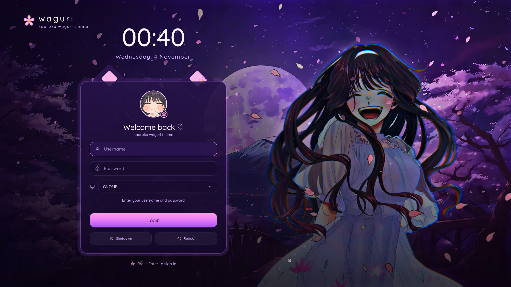

<div align="center">

# 🌸 Waguri - SDDM THEME

### A cute purple moonlit-sakura login theme for SDDM
*Inspired by Kaoruko Waguri from "The Fragrant Flower Blooms with Dignity" (Kaoru Hana wa Rin to Saku)*




</div>

---

## ✨ Features

- 🌙 Moonlit cherry-blossom scene with drifting petals and sparkles
- 🪟 Frosted-glass login card with a soft pink-purple glow
- 🕛 Large clock and date at the top
- 👤 Username and password fields with icons and focus highlight
- 🖥️ Session selector (GNOME, KDE Plasma, Hyprland, etc., whatever is installed)
- 🔘 Gradient **Login** button, plus **Shutdown** and **Reboot**
- 💬 "Welcome back ♡" greeting with a round avatar

## 📦 Requirements

- [SDDM](https://github.com/sddm/sddm)
- The Qt / QtQuick packages that SDDM already needs on your distro

## 🚀 Installation

**1. Clone the repo**

```bash
git clone https://github.com/anshalmanoj/waguri-sddm.git
cd waguri-sddm
```

**2. Copy the theme into SDDM's themes folder**

```bash
sudo cp -r waguri /usr/share/sddm/themes/
```

**3. Set it as the active theme**

Create or edit `/etc/sddm.conf.d/theme.conf`:

```ini
[Theme]
Current=waguri
```

**4. Log out or reboot** to see it. 💜

## 🧪 Preview without logging out

```bash
# SDDM with Qt6
sddm-greeter-qt6 --test-mode --theme /usr/share/sddm/themes/waguri

# SDDM with Qt5
sddm-greeter --test-mode --theme /usr/share/sddm/themes/waguri
```

## 🗑️ Uninstall

```bash
sudo rm -rf /usr/share/sddm/themes/waguri
```

Then remove or change the `Current=waguri` line in your SDDM config.

## 🛠️ Troubleshooting

- **Theme doesn't show up:** make sure the `waguri` folder is inside `/usr/share/sddm/themes/` and contains `metadata.desktop`.
- **Black screen or fallback theme:** run the preview command above and read the QML errors it prints.
- **Missing a Qt module:** install the Qt/QML packages for your SDDM version (Qt5 or Qt6) from your distro's repos.

## 🤝 Contributing

Issues and pull requests are welcome, whether it's a bug, a new color variant or a fix for your distro.

## ⚖️ Credits & Disclaimer

- Theme code by [Anshal Manoj](https://github.com/anshalmanoj). See [LICENSE](LICENSE).
- *Kaoru Hana wa Rin to Saku* and the character Kaoruko Waguri belong to their respective creators and rights holders (author Saka Mikami, anime by CloverWorks).
- This is an **unofficial fan-made project**, not affiliated with or endorsed by them.
- Artwork: **ADD ARTIST NAME + LINK HERE** (or note that you made it yourself).

If you are a rights holder and would like something removed, please open an issue and it will be taken down promptly.

---

<div align="center">

If you like it, a ⭐ on the repo means a lot! 🌸

</div>
